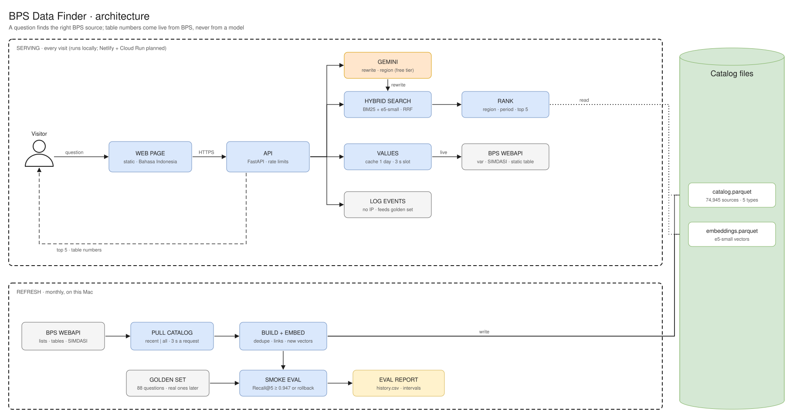

# BPS Data Finder

Ask for a statistic in plain Bahasa Indonesia or English and get the BPS table, publication or press release
that matches (dynamic table, static table, Dalam Angka table, publication, press release). For tables the page
also shows the numbers, copied verbatim from the BPS API: no language model ever writes a number.

## How it works



The diagram's source is `docs/architecture.py`; `docs/architecture.excalidraw` opens in excalidraw.com.

## Status

Live at https://cari-data-bps.netlify.app (page on Netlify) with the API on Cloud Run (`asia-southeast2`). Built: search
API (FastAPI), Bahasa-Indonesia-first web page, catalog refresh script and an evaluation report. See `CLAUDE.md` for decisions and next steps, and `docs/eval-report.html`
for how well the search finds the right source (Recall@5 0.977 on 88 generated questions, against 0.19 for
bps.go.id's own search; no real user questions yet).

## Data sources

- BPS WebAPI (webapi.bps.go.id): catalog of dynamic tables, static tables, Dalam Angka (SIMDASI) tables,
  publications and press releases for national, province and kab/kota; table values on request. Needs a free
  API key; about 20 requests a minute. The page shows the attribution the API terms require.
- Gemini API (free tier) rewrites the question into BPS wording. Without it the search still works, less well.

## How to run

```bash
uv sync
cp .env.example .env   # add BPS_API_KEY; GEMINI_API_KEY (aistudio.google.com) for the LLM rewrite
uv run python -m src.ingestion.pull_catalog    # resumable, ~20 requests/min
uv run python -m src.ingestion.build_catalog   # -> data/processed/catalog.parquet
uv run python -m evals.run_eval                # Recall@5 / MRR per method
scripts/refresh.sh [recent|all]                # refresh the catalog, embed new rows, smoke-test with the eval, save the indexes the API loads
uv run uvicorn app.main:app --port 8000        # API: /api/search?q=..., /api/value?doc_id=...
uv run pytest -q tests
npm install && npm run test:e2e                # page in real Chrome against a fake API
npm run serve -- 8080 http://localhost:8000    # the page on http://localhost:8080

# deploy (personal Google account through ./gcloud.sh, which reads the account's email from the ignored file .personal_account;
# Netlify token in web/.netlify.env)
scripts/publish_data.sh                        # catalog and saved indexes -> private bucket (applies on the next API start)
SITE_ORIGIN=https://cari-data-bps.netlify.app scripts/deploy_api.sh
API_ORIGIN=https://api-823141605435.asia-southeast2.run.app scripts/deploy_site.sh
uv run python scripts/check_live.py https://api-823141605435.asia-southeast2.run.app https://cari-data-bps.netlify.app
node tests/e2e/live.mjs                        # the live page in Chrome
```

This service uses the Badan Pusat Statistik (BPS) API.
